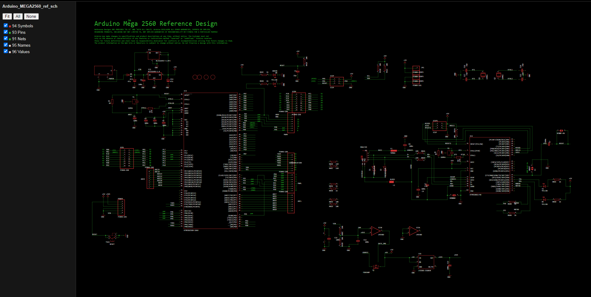

# EaglePCBView3D – Offline EAGLE Board & Schematic Viewer

**Version 1.0** - 2026-10-12

**EaglePCBView3D** is an offline renderer for **EAGLE** `.brd` / `.sch` files (XML format). It writes a static SVG and a standalone interactive `.htm` viewer for every file. Board viewers also embed a **3D view** that follows the layers you switch on and off in 2D.

Only the Python standard library is required (the GUI uses `tkinter`, which ships with the Windows Python installer).

> by **Arky** - [amigatronic.com](https://www.amigatronic.com)


## Features

- 2D viewer in a single `.htm` file (the `.htm` extension keeps it from being opened by a default browser you did not choose): mouse wheel zoom, drag to pan, per-layer checkboxes, `Fit`, `All`, `None`, and `Flip` (mirrors the board view).
- EAGLE-like colors and layer fill styles: every layer whose fill is not solid (fill other than 1, e.g. stop mask, keepout, restrict) is hatched, with a constant hatch size on screen like EAGLE. Wires, polygon outlines and rings on the keepout/restrict layers (39-43) are drawn at least 32 mil wide and hatched, like the stop mask layers.
- Holes (layer 45) are drawn as real holes, exactly like pad and via drills.
- Schematic and board are linked automatically: opening `test.sch` also renders `test.brd` (and vice versa).
- **3D rendering** button in every board HTML:
  - the board outline (layer 20) is extruded (1.6 mm);
  - the visible 2D layers are applied as texture on both faces (copper, plated pads, silkscreen, stop mask, keepout, restrict, ...);
  - pad drills (layer 17), via drills (layer 18) and holes (layer 45) are real through holes;
  - the 3D view follows the layer checkboxes of the 2D side panel, live while the 3D view is open;
  - solder mask color (green, red, blue, yellow, white, black, magenta/purple, orange, pink, gray, transparent), mask finish (glossy / matte) and pad finish (gold ENIG, tin HASL, bare copper) can be chosen from the 3D toolbar; the silkscreen color follows the mask;
  - Three.js and TrackballControls are embedded in the `.htm`, so the file is fully standalone (and large: this is expected).
- Simple `tkinter` GUI and a command line interface.

## Requirements

- Windows 10 and Python 3.8 or newer.
- A browser with WebGL for the 3D view.
- Nothing else to install or download: three.js r147 and its TrackballControls (both MIT licensed) are embedded, compressed, at the end of `eagle_pcb_view_3d.py`.

## Usage

GUI (no arguments):

```
python eagle_pcb_view_3d.py
```

Command line:

```
python eagle_pcb_view_3d.py board.brd -o OUTDIR [--no-pair] [--open]
```

| Option | Meaning |
| --- | --- |
| `-o`, `--outdir` | output folder (default: current folder, created if missing) |
| `--no-pair` | do not load the matching companion `.sch` / `.brd` |
| `--open` | open the generated `.htm` files in the browser |
| `--gui` | force the graphical interface |
| `-h` | full command line help |

## Output

For `board.brd` and `board.sch` you get:

```
board_brd.svg    board_brd.htm     (board, with the 3D rendering button)
board_sch.svg    board_sch.htm     (schematic, one pair per sheet if there are several)
```

## 3D view

- Left drag: rotate on all axes. Wheel: zoom. Right drag: pan.
- `Iso`, `Top`, `Bottom` buttons for the standard views; `Mask`, `Finish` and `Pads` selectors for the appearance.
- Untick a layer in the side panel and it disappears from the 3D view as well. Unticking layers 17, 18 or 45 also removes the corresponding drilled holes.
- Inner copper layers are not shown (they are not visible from outside). No component models are drawn.
- A closed board outline on layer 20 (Dimension) is required.

## Known limits

- Text uses a system font, so shapes and widths are approximated.
- Copper pours are not recalculated: polygons are drawn as translucent outlines.
- The ratsnest / airwires are not drawn.
- The board thickness is fixed at 1.6 mm (`.brd` files do not store the stack-up).

## Credits

by **Arky** - [amigatronic.com](https://www.amigatronic.com)

## License and disclaimer

Copyright (c) 2026 Arky - [amigatronic.com](https://www.amigatronic.com)

Released under the **MIT License** (full text in [LICENSE](LICENSE)).

**THIS SOFTWARE IS PROVIDED "AS IS", WITHOUT WARRANTY OF ANY KIND**, express or implied, including but not limited to merchantability, fitness for a particular purpose and non-infringement. There is no guarantee that the software is free of bugs beyond the known limits listed above. The 2D/3D output is a visual aid and must not replace your original EAGLE files or your manufacturing data. In no event shall the author be liable for any claim, damages or other liability arising from the use of the software.

Found a bug? Please report it to Arky through [amigatronic.com](https://www.amigatronic.com) (or open an issue if you are reading this on GitHub).

## Third-party code

`eagle_pcb_view_3d.py` embeds [three.js](https://threejs.org) r147 and its `TrackballControls` (part of the three.js examples), distributed under the MIT License. The full license notice is kept in the source, right above the embedded data.

```
MIT License - Copyright (c) 2010-2022 three.js authors
```
