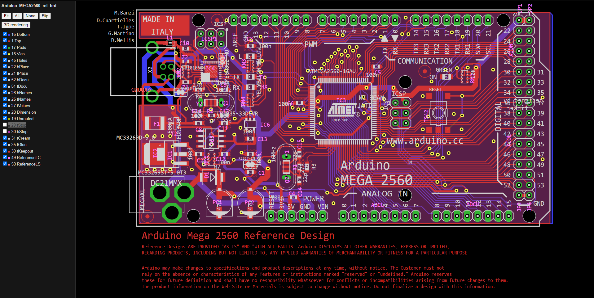
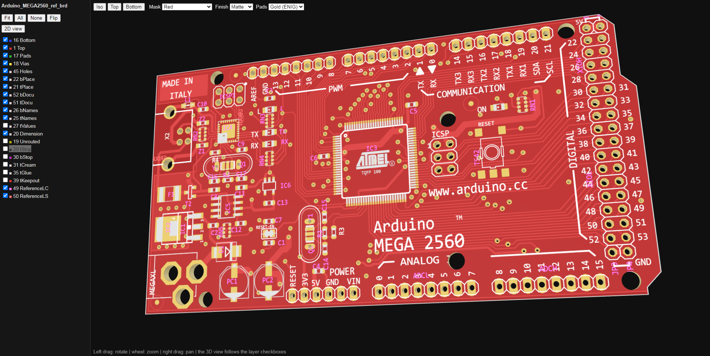

# EagleCAD Viewers - EAGLE `.brd` / `.sch` viewer (2D + 3D)

**Version 1.0** - by **Arky** - [amigatronic.com](https://www.amigatronic.com)

View **Autodesk EAGLE** boards (`.brd`) and schematics (`.sch`, XML format) without EAGLE: interactive 2D with per-layer switches and a 3D board view that follows the layers you enabled. Two editions share the same rendering ideas:

| | **Web edition** (`eagle_pcb_view_3d.php`) | **Desktop edition** (`eagle_view.py`) |
| --- | --- | --- |
| Runs on | a PHP web server (XAMPP locally, or online) | your PC, Python only |
| Online demo | <https://aviotronic.altervista.org/eagleviewer/> | - |
| Input | upload from the browser (drop or choose files) | file picker (GUI) or command line |
| Companion `.sch`/`.brd` | matched by file name among the selected files; a dialog offers to load a missing one | found automatically in the **same folder** on your disk |
| Output | viewers shown in the page (tabs, fullscreen) | `.svg` + standalone `.htm` files written to a folder |
| three.js | `three.min.js` + `TrackballControls.js` served next to the script | embedded in `eagle_view.py` and inlined in every board `.htm` (fully standalone, large) |
| 3D appearance | mask, finish, pads, **Light / Ambient / Track contrast sliders** | mask, finish, pads |
| Board outline | tolerant builder (see below) | chained segments, end points must meet |
| Privacy | uploads deleted right after rendering; viewers deleted when you leave | everything stays on your PC |

Source code: [GitHub - EagleCAD-Fusion / Python-Codes / eagle-viewers](https://github.com/amigatronic/EagleCAD-Fusion/tree/main/Python-Codes/eagle-viewers)





## Features (both editions)

- **2D viewer** in a single `.htm`: wheel zoom, drag to pan, one checkbox per layer, `Fit`, `All`, `None`, and `Flip` (mirrors the board view).
- **EAGLE-like layers**: colors from the file, hatched fill styles (every layer whose fill is not solid, e.g. stop mask, keepout, restrict) with a hatch size that stays constant on screen. Wires, polygon outlines and rings on keepout/restrict layers (39-43) are drawn at least 32 mil wide and hatched, like the stop mask layers.
- **Holes (layer 45)** are drawn as real holes, like pad and via drills.
- **Schematic viewer**: every sheet of the `.sch`, with layer toggles.
- **3D rendering** button on every board viewer:
  - the board outline (layer 20) is extruded (1.6 mm); outlines drawn inside component packages are included;
  - the visible 2D layers are applied as texture on both faces (copper, plated pads, silkscreen, stop mask, keepout, restrict, ...);
  - pad drills (layer 17), via drills (layer 18) and holes (layer 45) are real through holes;
  - the 3D view **follows the layer checkboxes** of the 2D panel, live while the 3D view is open (untick 17, 18 or 45 and the matching holes disappear too);
  - toolbar: `Iso` / `Top` / `Bottom` views, **solder mask** color (green, red, blue, yellow, white, black, magenta/purple, orange, pink, gray, transparent), **finish** (glossy / matte) and **pads** (gold ENIG, tin HASL, bare copper); the silkscreen color follows the mask;
  - mouse: left drag rotates on all axes, wheel zooms, right drag pans.

## Web edition (`eagle_pcb_view_3d.php`)

### Requirements

- PHP 7.4 or newer with the SimpleXML extension and file uploads enabled (developed and tested with PHP 8.3). On Windows, XAMPP is enough.
- `three.min.js` and `TrackballControls.js` (three.js **r147**: `build/three.min.js` and `examples/js/controls/TrackballControls.js`) placed next to `eagle_pcb_view_3d.php`, or inside `output/`.
- The upload limits (`upload_max_filesize`, `post_max_size`) of your `php.ini` must fit your files.

### Install

```
eagleviewer/
    eagle_pcb_view_3d.php
    three.min.js
    TrackballControls.js
```

Open `eagle_pcb_view_3d.php` in the browser (for example `http://localhost/eagleviewer/eagle_pcb_view_3d.php`). The `output/` folder is created automatically, with an `.htaccess` that disables the folder listing.

### How it works

1. **Add files**: drop `.brd` / `.sch` files on the page or use "Choose files...". Up to 12 files at a time; each project (same base name) is listed and can be ticked or unticked.
2. **Pairing**: `clock.brd` and `clock.sch` are matched by file name (case-insensitive). A web page cannot read a file from your disk that you did not select, so if one of the pair is missing, a dialog appears when you press Render: **Load Companion** (the picker lists only the missing type), **Ignore** (render the available file only) or **Cancel**. The server also reports the missing companion.
3. **Render**: the viewers appear in the page as tabs (Board / Schematic) with `Fullscreen` and "open in new tab". When a viewer is opened on its own, its side panel has links to the other viewer of the project.
4. **3D extras**: besides mask / finish / pads, the web 3D toolbar has **Light**, **Ambient** and **Track contrast** sliders (and `Reset`) to tune brightness and the contrast between mask and tracks.

### Privacy and cleanup

- Every render goes into its own folder `output/run-<random>/`.
- The uploaded source files are deleted as soon as they have been rendered.
- The run folder is deleted when you leave or close the page (browser beacon), when the same session starts a new render, and at the latest after 2 hours. Only the folders of your own session can be deleted from the page.

### Board outline (3D)

The outline builder works on the segments of layer 20 (wires, arcs, rectangles, polygons, circles), including those inside component packages: end points are snapped together (tolerance 0.05 mm, then 0.2 and 0.5 mm), segments are split where they touch or cross, dangling pieces are removed, and closed loops are extracted (the largest is the board, inner ones are cut-outs). If nothing closes, the 3D view is skipped and the message lists where the open ends are, for example `open ends near: (40, 0) mm, (43, 0) mm`.

## Desktop edition (`eagle_pcb_view_3d.py`)

### Requirements

- Windows 10+ and Python 3.8 or newer. Only the standard library is needed (`tkinter` ships with the Windows Python installer).
- A browser with WebGL for the 3D view.
- Nothing to download: three.js r147 and TrackballControls are embedded (compressed) at the end of the script.

### Usage

GUI (no arguments): choose the file, the output folder (by default the folder of the input file) and whether to load the companion file.

```
python eagle_view.py
```

Command line:

```
python eagle_pcb_view_3d.py board.brd -o OUTDIR [--no-pair] [--open]
```

| Option | Meaning |
| --- | --- |
| `-o`, `--outdir` | output folder (default: the current folder; created if missing) |
| `--no-pair` | do not load the matching companion `.sch` / `.brd` |
| `--open` | open the generated `.htm` files in the browser |
| `--gui` | force the graphical interface |
| `--version` | print the version |
| `-h` | full command line help |

Opening `board.sch` also renders `board.brd` from the same folder (and vice versa); if the companion is missing, the file you chose is still rendered and a message says so. The GUI has a help window with these notes and the credits.

### Output

```
board_brd.svg    board_brd.htm     (board, with the 3D rendering button)
board_sch.svg    board_sch.htm     (schematic, one pair per sheet if there are several)
```

The `.htm` files are fully standalone (the 3D libraries are inlined, so board files are large: this is expected). The `.htm` extension keeps them from being opened by a default browser you did not choose.

## Known limits

- Text uses a system font, so shapes and widths are approximated.
- Copper pours are not recalculated: polygons are drawn as translucent outlines.
- The ratsnest / airwires are not drawn.
- The 3D view shows no component models; inner copper layers are not shown; the board thickness is fixed at 1.6 mm (`.brd` files do not store the stack-up).
- The 3D view needs a closed outline on layer 20. In the desktop edition the outline segments must meet at their end points; the web edition is more tolerant.
- The solder mask colors are visual approximations, not measured samples.
- Only EAGLE files saved in XML format are supported.

## Credits

by **Arky** - [amigatronic.com](https://www.amigatronic.com)

## License and disclaimer

Copyright (c) 2026 Arky - [amigatronic.com](https://www.amigatronic.com)

Released under the **MIT License** (full text in [LICENSE](LICENSE)).

**THIS SOFTWARE IS PROVIDED "AS IS", WITHOUT WARRANTY OF ANY KIND**, express or implied, including but not limited to merchantability, fitness for a particular purpose and non-infringement. There is no guarantee that the software is free of bugs beyond the known limits listed above. The 2D/3D output is a visual aid and must not replace your original EAGLE files or your manufacturing data. In no event shall the author be liable for any claim, damages or other liability arising from the use of the software.

Found a bug? Please report it on the [GitHub repository](https://github.com/amigatronic/EagleCAD-Fusion/tree/main/Python-Codes/eagle-viewers) or through [amigatronic.com](https://www.amigatronic.com).

## Third-party code

The 3D view uses [three.js](https://threejs.org) r147 and its `TrackballControls` (part of the three.js examples), distributed under the MIT License: embedded in `eagle_view.py`, and shipped as separate files (`three.min.js`, `TrackballControls.js`) next to the PHP script.

```
MIT License - Copyright (c) 2010-2022 three.js authors

Permission is hereby granted, free of charge, to any person obtaining a copy of this software and
associated documentation files (the "Software"), to deal in the Software without restriction, including
without limitation the rights to use, copy, modify, merge, publish, distribute, sublicense, and/or sell
copies of the Software, and to permit persons to whom the Software is furnished to do so, subject to the
following conditions: The above copyright notice and this permission notice shall be included in all
copies or substantial portions of the Software.

THE SOFTWARE IS PROVIDED "AS IS", WITHOUT WARRANTY OF ANY KIND, EXPRESS OR IMPLIED, INCLUDING BUT NOT
LIMITED TO THE WARRANTIES OF MERCHANTABILITY, FITNESS FOR A PARTICULAR PURPOSE AND NONINFRINGEMENT. IN NO
EVENT SHALL THE AUTHORS OR COPYRIGHT HOLDERS BE LIABLE FOR ANY CLAIM, DAMAGES OR OTHER LIABILITY, WHETHER
IN AN ACTION OF CONTRACT, TORT OR OTHERWISE, ARISING FROM, OUT OF OR IN CONNECTION WITH THE SOFTWARE OR
THE USE OR OTHER DEALINGS IN THE SOFTWARE.
```
