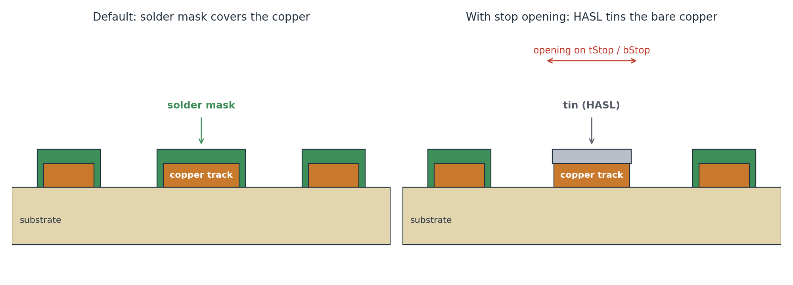
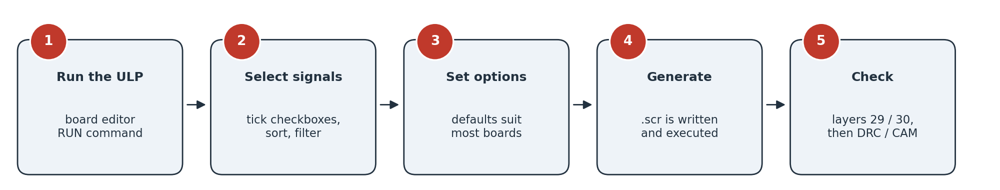
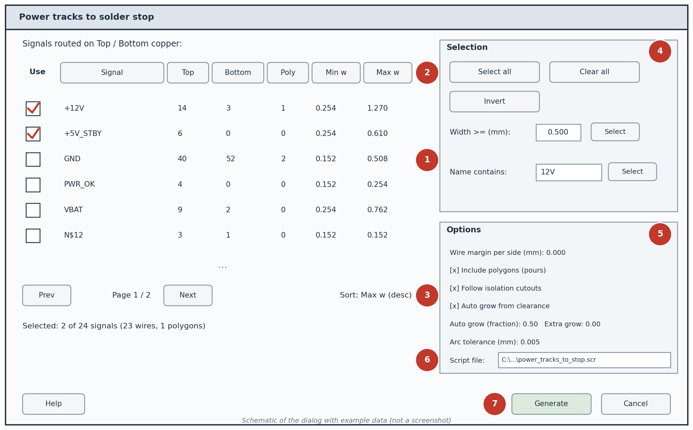
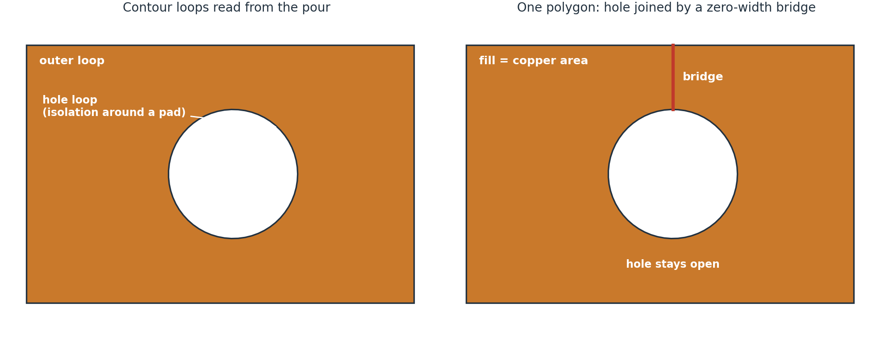
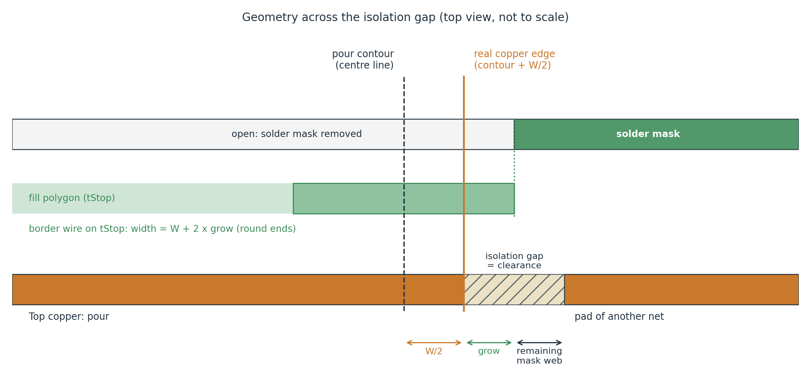

# Power Tracks to Solder Stop

[](LICENSE)


An EAGLE / Fusion 360 Electronics **ULP** that copies the copper of selected signals (tracks **and** pours)
onto the solder stop layers **tStop (29)** and **bStop (30)**. The solder mask is opened above the copper, so
during **HASL** the bare copper is tinned and the power tracks are reinforced.



## Table of contents

- [Why](#why)
- [Features](#features)
- [Requirements](#requirements)
- [Installation](#installation)
- [Quick start](#quick-start)
- [The dialog](#the-dialog)
- [Options](#options)
- [How it works](#how-it-works)
- [Good practice](#good-practice)
- [Limitations](#limitations)
- [Troubleshooting](#troubleshooting)
- [Documentation](#documentation)
- [Repository layout](#repository-layout)
- [Contributing](#contributing)
- [License](#license)

## Why

To reinforce a power track, its copper can be left bare: HASL deposits tin on every exposed copper surface and
increases the conductor cross-section. In EAGLE this means drawing, on the stop layer, a shape that covers the
track. Doing it by hand (copy the track, paste it on tStop or bStop) is slow and error-prone, especially for pours
with many isolation cutouts. This ULP does it automatically for the signals you choose.

| Copper source | Copied to | Layers |
|---|---|---|
| Top copper (wires and pours) | tStop | 1 -> 29 |
| Bottom copper (wires and pours) | bStop | 16 -> 30 |

## Features

- **Interactive dialog** listing every signal with wires or pours on Top/Bottom: wire counts, polygon count,
  minimum and maximum wire width.
- **Checkbox per signal**, paging, **sorting by any column**, and bulk selection (all, none, invert, by minimum
  width, by name).
- **Wires** copied with the same geometry (arcs included) and width, plus an optional margin. Wires already
  present on the stop layer are skipped.
- **Pours** copied following the **real poured copper**: isolation around other signals stays covered.
- **Automatic grow**: the opening around a pour is widened by a fraction of its clearance, so it always stays
  inside the isolation gap.
- **Built-in 5-page help** and a [PDF manual](docs/power_tracks_to_stop_manual.pdf).
- Free and open source, no dependencies: a single `.ulp` file.

## Requirements

- Windows 10
- EAGLE 9.x or Fusion 360 Electronics, with the **board editor** open
- Nothing else: the ULP runs `RATSNEST` itself at start so that the pours are calculated (can be disabled)

## Installation

1. Download [`power_tracks_to_stop.ulp`](power_tracks_to_stop.ulp).
2. Put it in a folder of your choice. In EAGLE, a folder listed under
   *Options > Directories > User Language Programs* makes the file appear in the ULP list.
3. In the board editor, type in the command line (adapt the path):

   ```
   RUN "C:\Users\you\ulp\power_tracks_to_stop.ulp"
   ```

   In EAGLE you can also use *File > Run ULP...* and browse to the file.

## Quick start



1. Save the board. The ULP runs `RATSNEST` by itself at start, so the pours are calculated and the dialog opens right after.
2. Run the ULP. The dialog lists the signals routed on Top/Bottom copper.
3. Tick the signals to expose. Sorting by **Max w** (descending) brings the widest tracks first, and
   **Width >=** selects them in one click.
4. To include pours, tick **Include polygons (pours)**. Keep the other options at their defaults.
5. Press **Generate**. A summary shows what was created and the generated script is executed.
6. Check layers 29 and 30 over the copper, then run the DRC and produce your manufacturing files as usual.

## The dialog



*Schematic of the dialog with example data (not a screenshot).*

| # | Area | Description |
|---|---|---|
| 1 | Signal list | One row per signal. The checkbox on the left marks the signal to expose. 16 rows per page. |
| 2 | Column headers | Click to sort by Signal, Top, Bottom, Poly, Min w or Max w; click again to reverse. |
| 3 | Navigation and status | Prev / Next change page (ticks are kept). Shows the current sort and the selected totals. |
| 4 | Selection tools | Select all, Clear all, Invert, `Width >=`, `Name contains`. They act on **all** signals. |
| 5 | Options | See below. |
| 6 | Script file | Path of the generated `.scr` file (default: the board's folder). |
| 7 | Buttons | **Help** (5 pages), **Generate**, **Cancel**. |

## Options

| Option | Default | Range | Effect |
|---|---|---|---|
| Wire margin per side (mm) | 0 | 0 to 2 | Extra width on each side of every copied wire. Not applied to pours. |
| Include polygons (pours) | off | - | Also copies the pours of the selected signals. |
| Follow isolation cutouts | on | - | Uses the real poured copper. If off, the polygon outline is used and the cutouts are ignored. |
| Auto grow from clearance | on | - | Widens the opening around each pour by a fraction of its clearance. |
| Auto grow (fraction) | 0.5 | 0 to 0.9 | Fraction of the clearance used as extra opening per side. |
| Extra grow per side (mm) | 0 | 0 to 1 | Manual extra opening, added to the automatic one. |
| Arc tolerance (mm) | 0.005 | 0.0005 to 0.1 | Maximum distance between a pour arc and the segments that approximate it. |
| Script file | board folder | - | Where `power_tracks_to_stop.scr` is written. |

The number of rows per page is the `PageSize` constant at the top of the ULP.

### Automatic RATSNEST

A ULP cannot run an EAGLE command and then continue. At start the program therefore ends, lets EAGLE execute
`RATSNEST`, and launches itself again with an extra argument that prevents a loop, so the dialog appears a moment
later. `RATSNEST` recalculates the pours and marks the board as modified. To disable it, set `RunRatsnest = 0` at the
top of the ULP and run `RATSNEST` yourself.

## How it works

The ULP does not modify the board directly. It writes an EAGLE script (`.scr`) with `LAYER`, `WIRE` and `POLYGON`
commands and runs it with `SCRIPT`.

**Wires.** Each wire of a selected signal on layer 1 or 16 is copied to layer 29 or 30 with the same end points,
curvature and width (plus twice the margin). A wire that already exists on the stop layer with identical geometry is
skipped.

**Pours.** A pour cannot simply be copied, because its outline does not show the isolation around other signals.
The ULP reads the *poured contour* computed by EAGLE:

1. Contour wires are chained into closed loops; arcs become short segments (arc tolerance).
2. Each loop is classified by nesting: outer boundary, hole, or island inside a hole.
3. Each hole is joined to its outer boundary by a zero-width bridge that lies inside the copper, giving one polygon.
4. The polygon is written with a hairline edge (it only fills the area).
5. The pour border is drawn with wires as wide as the pour width, plus the grow, along the same contour.



EAGLE draws the pour border as a wire of the pour width centred on the contour, so the real copper edge is half that
width beyond the contour. The automatic grow is `fraction x clearance`, where the clearance is the pour's isolate
value or, if it is 0, the clearance of the signal's net class (0.2 mm if both are 0). With the default 0.5 the opening
ends halfway into the isolation gap, so it never reaches neighbouring copper.



Example of the generated script (values are illustrative):

```
GRID mm;
LAYER 29;
WIRE 0.5080 (12.7000 25.4000) (30.4800 25.4000);
LAYER 29;
POLYGON 0.0010
  (10.0000 10.0000) (50.0000 10.0000) (50.0000 40.0000) (10.0000 40.0000)
  (10.0000 10.0000);
LAYER 29;
WIRE 0.6556 (10.0000 10.0000) (50.0000 10.0000);
```

## Good practice

- **Save the board before generating.** To revert, use undo or reload the saved file; a long script can produce many
  undo steps.
- **Check the mask web.** The opening is deliberately a little wider than the copper. Ask your manufacturer for the
  minimum solder mask web between exposed copper and neighbouring pads, and lower the auto grow if needed.
- **Pours are recalculated at every start** (`RATSNEST` runs automatically). Regenerate after any change to the pours or to nearby copper.
- **Do not generate the same pours twice** without removing the previous stop polygons: duplicate wires are
  detected, polygons are not.
- **Inspect the result** with only layers 1/16 and 29/30 visible, and look at the Gerber output before ordering.

## Limitations

- Only wires and polygons that belong to signals are listed. Unassigned wires and polygons are ignored.
- Pads, vias, holes and text are not copied (the solder stop already opens pads and vias).
- The default auto grow fraction (0.5) is a conservative starting point, not derived from a specific
  manufacturer's rules.
- In Fusion 360 Electronics the board may be stored in the cloud: if the script file cannot be written, choose a local
  folder in the *Script file* field.

## Troubleshooting

| Symptom | Likely cause | What to do |
|---|---|---|
| Message: run from the board editor | Started from another editor | Open the board and run it there |
| A signal with only a pour is missing | The pour is not on layer 1 or 16 | Check the layer of the pour |
| Warning about uncalculated polygons | The pour was not calculated, only the outline was used | Run `RATSNEST` by hand (the automatic run may be disabled) and generate again |
| Isolation cutouts covered by the opening | *Follow isolation cutouts* is off, or outline fallback | Turn it on and calculate the pours |
| Thin strip of copper still under mask | Grow too small | Increase the auto grow fraction or the extra grow |
| Opening reaches neighbouring pads | Grow too large for the clearance | Lower the auto grow fraction and the extra grow |
| Wires or polygons appear twice | Script generated twice | Undo or delete the stop objects and generate once |
| Script file cannot be written | Read-only or cloud-only folder | Change *Script file* to a local folder |
| Compile or runtime error | - | Open an issue with the exact message and line number |

## Documentation

- [User manual (PDF)](docs/power_tracks_to_stop_manual.pdf) - installation, interface reference, how it works,
  troubleshooting.
- Built-in help: press **Help** in the dialog.
- The figures are schematic drawings, not screenshots of EAGLE. The scripts that generate them and the manual are in
  [`docs/src`](docs/src).

## Repository layout

```
power-tracks-to-solder-stop/
|-- power_tracks_to_stop.ulp            the program
|-- README.md
|-- LICENSE                             MIT
|-- CHANGELOG.md
|-- .gitignore
`-- docs/
    |-- power_tracks_to_stop_manual.pdf
    |-- images/                         figures used by the README and the manual
    `-- src/                            scripts that regenerate figures and manual
```

## Contributing

Issues and pull requests are welcome. When reporting a problem please include:

- EAGLE or Fusion 360 Electronics version
- The exact error message and line number, if any
- The values of the dialog options and the summary shown after *Generate*
- A screenshot of the area involved, with layers 1/16 and 29/30 visible

## License

Released under the [MIT License](LICENSE).
